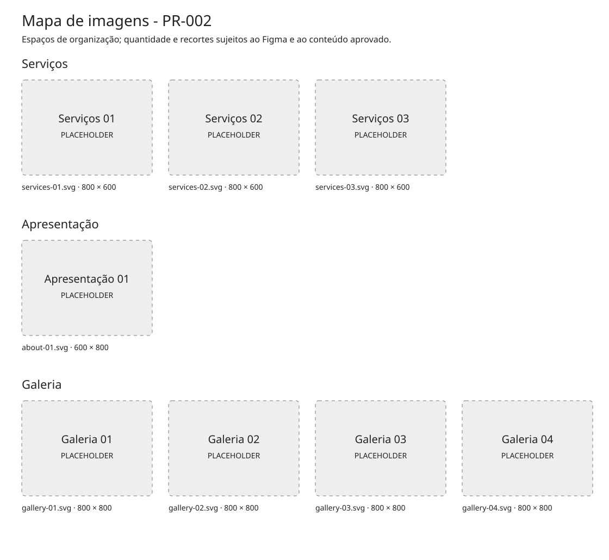

# Assets - PR-002

`placeholders/` contém apenas SVGs locais explicitamente provisórios. Não há fotografias autorizadas disponíveis nesta entrega.

Adicionar assets reais aqui quando recebidos, com nomes em minúsculas e hífens (por exemplo `servico-nome.webp`). Otimizar os arquivos, retirar metadados desnecessários e registrar origem/autorização na referência de aprovação em `src/content/`. Não copiar imagens do Instagram ou de PDFs como assets finais.

O manifesto `src/content/images.ts` centraliza URL pública, alt e dimensões. Os placeholders devem ser substituídos antes da publicação das seções correspondentes.

## Mapa dos espaços

| Área | Pasta | Espaços provisórios |
| --- | --- | --- |
| Serviços | `placeholders/services/` | `services-01.svg` a `services-03.svg` |
| Apresentação | `placeholders/about/` | `about-01.svg` |
| Galeria | `placeholders/gallery/` | `gallery-01.svg` a `gallery-04.svg` |

Esses quadros ajudam a separar e identificar os materiais para a próxima pessoa. Não definem quantidade de serviços oferecidos, galeria final, layout ou recorte aprovado. Acrescentar/remover espaços conforme o handoff real.

`imageSlots`, exportado por `@/content`, reúne os caminhos, dimensões e pendências por área. Os dois placeholders genéricos anteriores continuam disponíveis para preservar os contratos já criados. A prancha `map.svg` é documentação visual, não um asset para a página.
